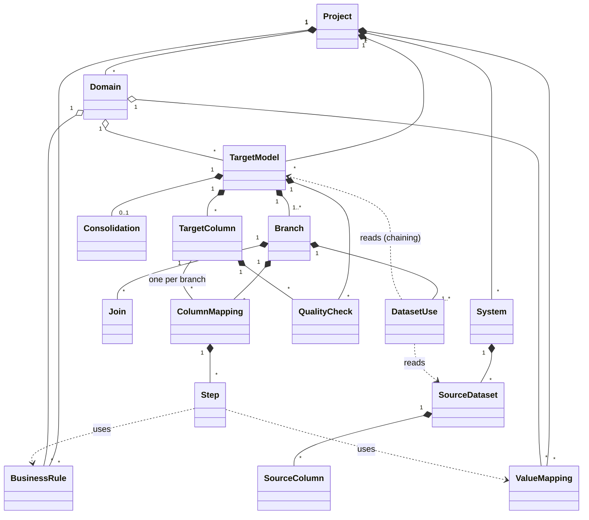

# 02 — Metamodel

Status: Validated
Last updated: 2026-11-04

This document is the **authoritative definition of the concepts** of Atlas (`CLAUDE.md`, rule 5). Any change of
concept is made here first, then in the Zod schemas of `packages/core`. The YAML grammar is defined in
`docs/03-spec-format.md`; validation details in `docs/05-modules/validation.md`.

Requirement identifiers: `MM-xxx`.

## 1. Purpose and boundaries

### 1.1 Two families of objects
| Family | Where it lives | Open source | Content |
|---|---|---|---|
| **Spec domain** | Atlas; exportable as YAML files (`docs/03-spec-format.md`); `packages/core` | Yes | Everything that describes a source-to-target specification: sources, targets, mappings, rules, quality checks, approvals. |
| **Platform domain** | Atlas database only | No | Organizations, accounts, credits, review workflow, support (§11). Never part of an export. |

- MM-001: The spec domain must be complete on its own: the CLI can validate and generate from the YAML files
  without the SaaS.
- MM-002: The spec domain never contains customer data (rows), secrets or connection credentials. Value mappings
  (§6.2) are reference lists, not business data.

### 1.2 Design principles
1. **Target first.** A spec starts from the target: what the final table means, its grain, its quality. Then, per
   source system, where each column comes from. This is how mapping workbooks are read, made structured.
2. **Multi-system by construction.** A target model is fed by one or more **branches**, one per source path
   (e.g. SAP France, SAP Germany, Oracle EBS, MES), combined by union and then consolidated.
3. **Everything is a typed object.** Joins, conditions, conversions and rules are structured. Free SQL is allowed
   only as an explicit, visible escape hatch (§5.4).
4. **Stable identity.** Every object has an id that does not change when its display name changes, so references,
   diffs and approvals survive renames (§9).
5. **Business owns the meaning.** Each target model and business rule belongs to a **domain** with an accountable
   owner and stewards (§2.2).

## 2. Overview

### 2.1 Diagram

### 2.2 Objects at a glance
| Object | In one line | Section |
|---|---|---|
| Project | The container of one specification. | §3.1 |
| Domain | A business area with an accountable owner and stewards. | §3.2 |
| System | A source system: ERP, MES, CRM, database, file, API. | §3.3 |
| Source dataset / source column | A table, view or file of a system, and its columns. | §3.4 |
| Target model / target column | A target table and its columns: meaning, type, grain, quality. | §4.1 |
| Branch | One source path feeding a target model: datasets, joins, filters, grain. | §4.2 |
| Join | A structured join between two datasets of a branch. | §4.3 |
| Consolidation | How branches are combined: union, then matching and survivorship. | §4.4 |
| Column mapping | For one target column in one branch: inputs and a pipeline of steps. | §5 |
| Business rule | A named, reusable, parameterized piece of logic owned by a domain. | §6.1 |
| Value mapping | A code translation table (e.g. SAP plant codes → target codes). | §6.2 |
| Quality check | An expectation on a column or a model (not null, unique…). | §8 |
| Review unit / approval | What is approved, by whom, on which content. | §10 |

## 3. Context objects

### 3.1 Project
| Attribute | Required | Description |
|---|---|---|
| id | yes | Stable identifier. |
| name | yes | Display name. |
| description | no | Purpose of the project (e.g. "Multi-ERP consolidation 2027"). |
| targetPlatform | yes | Dialect of the generated code: `snowflake` in v1; `databricks`, `bigquery`, `postgresql` later. |
| defaults | no | Project defaults, e.g. naming convention, default materialization. |

- MM-010: A project contains all the objects below. References never cross projects in v1.

### 3.2 Domain
A business area (Finance, Sales, Supply chain, Production…) that **owns** target models, business rules and value
mappings, and is **responsible** for their meaning.

| Attribute | Required | Description |
|---|---|---|
| id, name | yes | |
| description | no | Scope of the domain. |
| owner | yes | The accountable person (one person). |
| stewards | yes | People who review and approve the domain's objects (one or more). |

- MM-020: Every target model, business rule and value mapping belongs to exactly one domain.
- MM-021: A domain must have at least one steward, so that its objects can always be approved. Several stewards
  avoid blocking a review when one is absent.
- MM-022: People are referenced by the e-mail of their Atlas account. The SaaS resolves them; the CLI treats them as
  plain text.
- MM-023: A person can be owner or steward of several domains.
- MM-024: Only an Admin can change a domain's owner or stewards. Such a change made elsewhere (e.g. in an edited export)
  is flagged and does not take effect until an Admin confirms it; otherwise anyone able to edit the YAML could make
  themselves steward.

### 3.3 System
| Attribute | Required | Description |
|---|---|---|
| id, name | yes | E.g. `sap_fr` / "SAP France". Two instances of the same product are two systems. |
| kind | yes | `erp`, `mes`, `crm`, `database`, `file`, `api`, `other`. |
| product | no | Vendor product and version, e.g. "SAP S/4HANA 2023", "Oracle E-Business Suite 12.2". |
| landing | yes for generation | Where the system's raw data lands in the warehouse (database, schema, naming pattern). Ingestion itself is out of scope (NG-002); Atlas only needs to know where to read. |
| description | no | |

- MM-030: Connection details and credentials are **not** part of the system object. They belong to the platform
  domain (§11).

### 3.4 Source dataset and source column
| Attribute (dataset) | Required | Description |
|---|---|---|
| id | yes | Unique within its system. |
| system | yes | Owning system. |
| name | yes | Physical name in the source (e.g. `KNA1`, `HZ_PARTIES`). |
| namespace | no | Database / schema in the source, when relevant. |
| kind | yes | `table`, `view`, `file`, `other`. |
| primaryKey | no | Ordered list of key columns. |
| landingName | no | Override of the landed table name when it differs from the pattern. |
| description | no | |
| metadataOrigin | yes | `manual`, `file-import` or `cli-import` (later, UC-005), plus import date. |

| Attribute (column) | Required | Description |
|---|---|---|
| name | yes | Physical name (case preserved). |
| nativeType | no | Type as declared in the source (e.g. `NVARCHAR(40)`, `CHAR(10)`). |
| logicalType | yes | Normalized type (§7). Derived from `nativeType` when possible. |
| nullable | no | Unknown if not given. |
| description | no | |

- MM-040: Source metadata is descriptive. Changing it does not change any target definition, but validation
  re-checks every mapping that uses it.

## 4. Target side

### 4.1 Target model and target column
The target side is written first: it is the contract that every branch must fulfil.

| Attribute (model) | Required | Description |
|---|---|---|
| id, name | yes | E.g. `dim_customer`. |
| domain | yes | Owning domain (MM-020). |
| description | yes | Business meaning of one row. |
| grain | yes | What one row represents, and the key columns that make it unique. |
| layer | no | Free label: `staging`, `intermediate`, `mart`… |
| materialization | no | `table`, `view`, `incremental`. Default from project. |
| historization | later | Not in v1. Will be `none` (default) or `scd2` (keep history of changes). Optional, so adding it later does not break existing specs. |
| branches | yes | One or more branches (§4.2). |
| consolidation | when > 1 branch | How branches are combined (§4.4). |
| qualityChecks | no | Model-level checks (§8). |
| tags | no | |

| Attribute (column) | Required | Description |
|---|---|---|
| name | yes | Physical target name. |
| definition | yes | Business definition, written for the steward. |
| logicalType | yes | Target type (§7). |
| nullable | yes | |
| key | no | Part of the grain key. |
| classification | no | `public`, `internal`, `confidential`, `personal` (GDPR). Exported to ODCS. |
| qualityChecks | no | Column-level checks (§8). |
| tags | no | |

- MM-100: A target column has **exactly one mapping per branch** of its model. When a branch cannot provide the
  column, the mapping says so explicitly (`notProvided`, with a reason), and the column must then be nullable or
  get a value from consolidation.
- MM-101: The grain key columns must be not-null and unique after consolidation; Atlas generates the matching
  quality checks automatically.

### 4.2 Branch
A branch is **one source path** feeding the target model, typically one per system. It is the structured
equivalent of the `FROM … JOIN … WHERE … GROUP BY` of one part of the union.

| Attribute | Required | Description |
|---|---|---|
| id | yes | E.g. `sap_fr`. Unique within the model. |
| label | no | Human label. |
| datasets | yes | Dataset uses: each one names a source dataset **or another target model** (chaining), with an alias. The first one drives the grain. |
| joins | no | Joins between the datasets of the branch (§4.3). |
| filter | no | A condition (§5.3) keeping only the relevant rows. |
| deduplicate | no | Within the branch: key, ordering, keep first or last. |
| groupBy | no | When the branch aggregates: the grouping columns. |
| sourceTag | no | Value written in the optional source column of the model (e.g. `SAP_FR`), for lineage. |

- MM-110: Aliases allow the same dataset to be used twice (e.g. the same address table for billing and shipping).
- MM-111: A dataset use that reads a target model makes a **chain**. Chains must not form cycles.
- MM-112: When `groupBy` is set, every column mapping of the branch is either a grouping column or ends with an
  aggregation step (§5.2).

### 4.3 Join
| Attribute | Required | Description |
|---|---|---|
| left, right | yes | Aliases of two dataset uses of the branch. |
| type | yes | `inner`, `left`, `right`, `full`. |
| on | yes | A condition (§5.3), usually equalities between key columns. |
| cardinality | yes | Expected relationship: `one-to-one`, `one-to-many`, `many-to-one`, `many-to-many`. |
| description | no | Why the join exists, in business words. |

- MM-120: Join conditions only compare columns of compatible logical types.
- MM-121: A `many-to-many` join is a warning: it multiplies rows. It must be confirmed explicitly.
- MM-122: The declared cardinality is checked against the declared keys when they are known.

### 4.4 Consolidation
Applied when a model has several branches.

| Attribute | Required | Description |
|---|---|---|
| combine | yes | `union-all` (keep every row) or `union-distinct`. |
| addSourceColumn | no | Name of a column that receives each branch's `sourceTag`. |
| match | no | Key that identifies the same real-world entity across branches (e.g. VAT number). |
| survivorship | with match | Which value wins when several branches describe the same entity: a **branch priority** list for the whole row, optionally overridden per column (priority list, most recent, first not null, or a business rule). |

- MM-130: Without `match`, rows from different branches are never merged.
- MM-131: Survivorship covers the "take it from the CRM, else from the ERP" case at column level.

## 5. Column mapping

### 5.1 Structure
A column mapping says, for **one target column in one branch**, which inputs are used and which ordered steps
transform them.

| Attribute | Required | Description |
|---|---|---|
| target | yes | Target column. |
| branch | yes | Branch. |
| inputs | no | Source columns, as `alias.column`. Empty for a constant. |
| steps | no | Ordered pipeline (§5.2). No step and one input = direct copy. |
| notProvided | no | Instead of inputs and steps: the reason the branch cannot provide the column. |
| note | no | Free comment for humans. Never interpreted. |

### 5.2 Step kinds
All the kinds below are in v1.

| Kind | What it does | Main attributes |
|---|---|---|
| `copy` | Direct copy (implicit when there are no steps). | — |
| `constant` | A fixed value. | value |
| `default` | Replaces null (or empty) with a value. | value, alsoEmpty |
| `convert` | Type conversion. | to (logical type), method (`cast`, `parse`, `format`), pattern (e.g. date format `YYYYMMDD`), onError (`fail`, `null`, `default`) |
| `mapValues` | Translates codes through a value mapping. | mapping, onUnmatched (`keep`, `null`, `default`, `fail`) |
| `case` | Conditional logic. | when: list of (condition, result), else |
| `calculate` | A function from the Atlas function catalog (arithmetic, rounding, dates, text). | function, arguments |
| `concat` | Concatenation of several values. | parts, separator |
| `lookup` | Fetches one value from another dataset, without changing the branch's rows. | dataset, match (condition), return column, onMissing |
| `aggregate` | Aggregation, when the branch has `groupBy`. | function (`sum`, `count`, `count-distinct`, `min`, `max`, `avg`) |
| `rule` | Applies a reusable business rule (§6.1). | rule, arguments |
| `sql` | **Escape hatch**: a raw SQL expression. | expression, dialect, reason |

- MM-200: The output type of each step is known. The last step's type must be compatible with the target column's
  logical type (§7.2); otherwise a `convert` step is required.
- MM-201: A `lookup` must be `many-to-one` on its match: it can never multiply rows.
- MM-202: The function catalog of `calculate` is defined in `packages/core`; each generator translates it into its
  dialect. A function missing from the catalog is a reason to use `sql`, and a signal to extend the catalog.

### 5.3 Conditions and operands
Conditions are used by joins, filters, `case`, `lookup` and quality checks. They are structured, never strings.

- **Operands**: a column (`alias.column`), a literal (typed), a rule parameter.
- **Comparison**: operand, operator (`=`, `!=`, `<`, `<=`, `>`, `>=`, `in`, `not-in`, `between`, `like`,
  `is-null`, `is-not-null`), operand(s).
- **Groups**: `all` (and), `any` (or), `not`.
- **Escape hatch**: `sql` (§5.4).

### 5.4 Escape hatch (`sql`)
- MM-210: A `sql` step or condition must state a `reason`.
- MM-211: It is shown everywhere as **unstructured** (editor, review, documentation), and validation reports it as
  a warning. Atlas cannot check its types or lineage, and generators copy it as is (Snowflake in v1).
- MM-212: The share of unstructured logic is reported per project, as a quality indicator of the spec.

## 6. Reusable logic

### 6.1 Business rule
A rule written once, owned by a domain, approved by its stewards, used by many columns. Examples: "Net amount =
gross amount − discounts", "Customer status from blocking flags", "Fiscal period from posting date".

| Attribute | Required | Description |
|---|---|---|
| id, name | yes | |
| domain | yes | Owning domain (MM-020). |
| statement | yes | The rule in business words, for the steward. |
| parameters | yes | Named, typed inputs. |
| logic | yes | A pipeline of steps (§5.2), working on the parameters. |
| returns | yes | Logical type of the result. |

- MM-300: A rule cannot reference itself, directly or through other rules.
- MM-301: A business rule is a review unit of its own (§10).

### 6.2 Value mapping
| Attribute | Required | Description |
|---|---|---|
| id, name | yes | E.g. `plant_codes_sap_to_group`. |
| domain | yes | Owning domain. |
| fromType, toType | yes | Logical types. |
| entries | one of | List of (from, to) pairs, stored in the spec. |
| reference | one of | For large lists: a dataset and two columns (key, value) to read from. |
| default | no | Value when no entry matches. |

- MM-310: Inline entries are limited to 1,000. Beyond that, use `reference`.
- MM-311: The `from` values are unique.

## 7. Type system

### 7.1 Logical types
`boolean`, `integer`, `bigint`, `decimal(precision, scale)`, `float`, `string(maxLength?)`, `date`, `time`,
`timestamp`, `timestamp-tz`, `binary`, `json`.

- MM-400: Each logical type has a defined mapping to each supported source dialect (PostgreSQL, SQL Server, file
  imports) and target dialect (Snowflake first), and to ODCS `logicalType` / `physicalType`.

### 7.2 Compatibility
- MM-410: Safe widening is implicit (e.g. `integer` → `bigint`, `string(10)` → `string(40)`, `date` →
  `timestamp`).
- MM-411: Any other change needs an explicit `convert` step, with its error behaviour.
- MM-412: Known traps are flagged even when explicit, e.g. text to number with leading zeros (SAP numbering),
  dates stored as text, decimal precision loss.

## 8. Quality checks
Basic checks in v1. They generate dbt tests and the quality section of an ODCS export.

| Check | Level | Meaning |
|---|---|---|
| `not-null` | column | No null values. |
| `unique` | column | No duplicates. |
| `accepted-values` | column | Values within a list or a value mapping's target values. |
| `relationship` | column | Every value exists in a column of another target model. |
| `unique-combination` | model | The combination of columns is unique (used for the grain, MM-101). |

- MM-500: Each check has a severity: `error` (blocks) or `warn`.

## 9. Identity and references
- MM-600: Every object has an `id`: lowercase letters, digits, `_` and `-`, unique among its siblings. The display
  name can change freely; the id is changed only by an explicit rename, which updates every reference.
- MM-601: References use ids and paths, e.g. `sap_fr.kna1.KUNNR` (system, dataset, column) or
  `dim_customer.country_code` (model, column).
- MM-602: Every reference must resolve. A broken reference is a validation error, never a silent null.
- MM-603: A **canonical serialization** of each object is defined in `packages/core`. It is the basis of diffs and of
  approval hashes (ADR 0007).

## 10. Review and approval
| Concept | Description |
|---|---|
| **Review unit** | Something that can be approved: the whole project, a target model, a column mapping (one target column, all its branches), a business rule, a value mapping. |
| **Approval record** | Unit, decision (`approved` or `rejected`), person, date, comment, **content hash** of the unit. Stored in Atlas's approval log; included in exports (ADR 0007). |
| **Status** | `draft`, `in-review`, `approved`. Derived, not stored: from the latest valid record and the open review requests (platform domain). |

- MM-700: The content hash of a unit covers its own definition **and** the hashes of the business rules and value
  mappings it uses. Changing a rule therefore marks every approval that depends on it as outdated.
- MM-701: A unit is **effectively approved** when it has a valid approval of its own, or when it is covered by a
  valid approval of a unit that contains it (e.g. a model approved as a whole).
- MM-702: Approvals of objects owned by a domain are given by the stewards of that domain. Approval of the whole
  project is given by holders of the project-level Approver permission (`docs/01-scope.md` §2.3).

## 11. Platform domain (summary)
Kept in the Atlas database, never in the spec. Detailed in `docs/04-architecture.md`.

| Object | Notes |
|---|---|
| Organization | Customer contact details, credits (ADR 0002). |
| Account | Role (Admin, Editor, Viewer), permissions (Approver, Self-approval), status (active, suspended). |
| Credit ledger, deletion requests | ADR 0002. |
| Support messages, support access grants | ADR 0002. |
| Project settings | Defaults, AI switch. |
| Review requests, comments | The workflow around approvals. |
| Approval log | The authoritative log of approvals (ADR 0007). |

## 12. Illustrative example
`dim_customer`, domain Sales, fed by SAP France, SAP Germany and Oracle EBS.

| Element | Content |
|---|---|
| Grain | One row per customer of the group; key `customer_id`. |
| Branch `sap_fr` | `kna1` (alias `c`) joined to `knvv` (alias `s`, `left`, `one-to-many` → filtered on the main sales area); sourceTag `SAP_FR`. |
| Branch `sap_de` | Same structure on system `sap_de`; sourceTag `SAP_DE`. |
| Branch `oracle` | `hz_cust_accounts` (alias `a`) joined to `hz_parties` (alias `p`, `inner`, `many-to-one`); sourceTag `ORACLE`. |
| Consolidation | `union-all`, add column `source_system`, match on VAT number, branch priority `sap_fr` > `sap_de` > `oracle`. |
| `country_code` | `sap_fr` and `sap_de`: copy of `c.LAND1`. `oracle`: `p.COUNTRY` then `mapValues` with `country_codes_oracle_to_iso`. |
| `customer_status` | All branches: `rule` `customer_status_from_flags`, owned by Sales, approved by its steward. |
| `credit_limit` | `sap_fr`, `sap_de`: `notProvided` ("held in the credit management module, phase 2"). `oracle`: `lookup` in the credit profile table. |

## 13. Decisions log
- Q-MM-01: Domain stewards approve their domain's objects; the project-level Approver permission covers approval
  of the whole project (MM-702, `docs/01-scope.md` §2.3).
- Q-MM-02: A person can be owner or steward of several domains (MM-023).
- Q-MM-03: Inline value mappings are limited to 1,000 entries (MM-310).
- Q-MM-04: `scd2` historization comes later; it is an optional attribute, so it does not affect v1 (§4.1).
