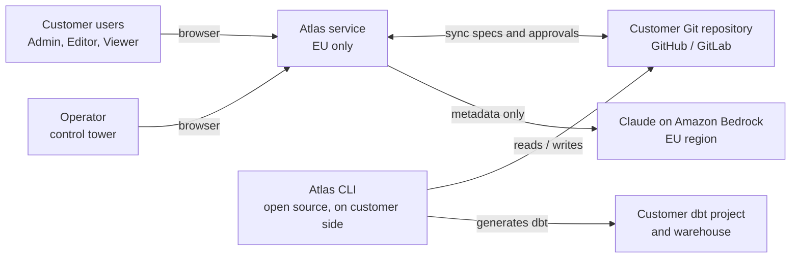
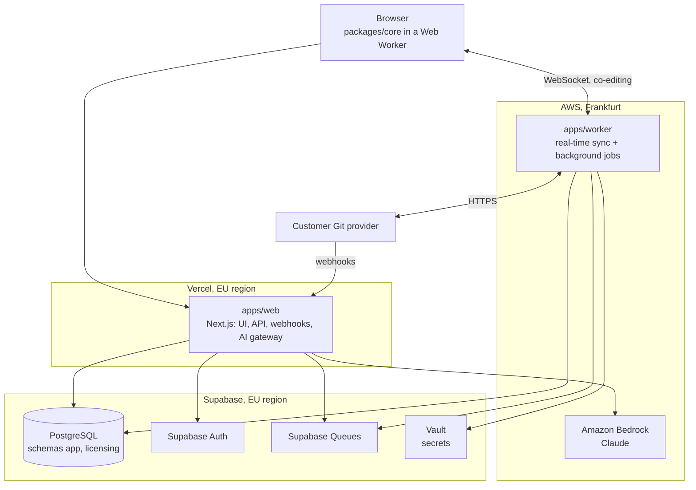
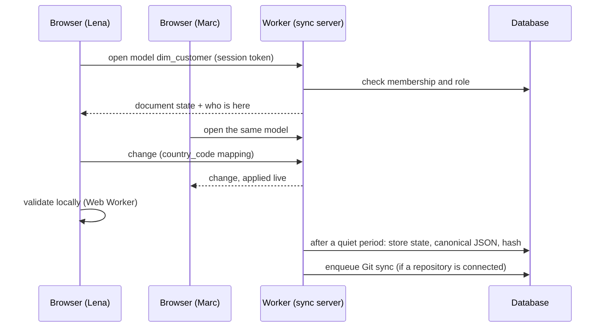
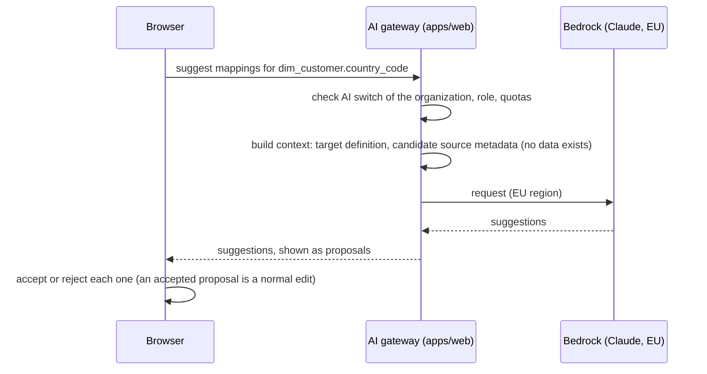

# 04 — Architecture

Status: Draft
Last updated: 2026-11-04

This document describes the components of Atlas, how they talk to each other, and how security, confidentiality
and multi-tenancy are enforced. Decisions are recorded in ADRs:

- ADR 0001: stack;
- ADR 0002: control tower and operator access;
- ADR 0003: Git sync of specs and approvals;
- ADR 0004: AI provider;
- ADR 0005: real-time co-editing;
- ADR 0006: worker service and background jobs.

Requirement identifiers: `ARC-xxx`.

## 1. Overview

### 1.1 Context

- ARC-001: Atlas never connects to customer databases, warehouses or source systems (OOS-006). Its only outbound
  links are the customer's Git repository, the AI provider and its own infrastructure.

### 1.2 Containers

## 2. Components

| Component | Role | Must never |
|---|---|---|
| **`packages/core`** | Metamodel (Zod), YAML parser/serializer, canonical form and hashes, validation, generators. Runs in the browser, on the server, in the worker and in the CLI. | Depend on UI, database, network or any SaaS service (ADR 0001 §4.3). |
| **`packages/cli`** | `atlas validate`, `generate`, `import` (dictionary files, ODCS), `diff`. Works offline on the YAML files. | Need an account or a network connection for validation and generation. |
| **`apps/web`** | Screens (Next.js), server actions and API, Git webhooks reception, AI gateway, control tower area (ADR 0002). | Hold a long-lived connection or run long jobs (Vercel functions are time-limited): both go to the worker. |
| **`apps/worker`** | Real-time co-editing server (ADR 0005) and background jobs (ADR 0006): Git sync, large validations and generations, batch AI suggestions. | Expose anything to the operator role. |
| **PostgreSQL (Supabase)** | All persistent state, with row-level security (§5). | Contain customer data (rows of customer tables): metadata only. |
| **Supabase Auth** | Accounts, sessions, MFA, SAML SSO. | |
| **Supabase Queues** | Durable job queue between `apps/web` and `apps/worker`. | |
| **Supabase Vault** | Git credentials and other secrets, encrypted. | Be readable by the operator role. |
| **Amazon Bedrock** | Claude, for AI suggestions (ADR 0004). | Receive anything but project metadata; be called without the organization's AI switch on. |

### 2.1 Where validation runs
- ARC-010: Validation runs **in the browser** (Web Worker) on every change, for immediate feedback.
- ARC-011: The **server** (worker) re-runs validation on saved content; its result is the reference shown in reviews
  and used before generation.
- ARC-012: The CLI runs the same validation in CI. One code base, one result.
- ARC-013: Invalid content can always be saved as a draft: validation informs, it never blocks editing.

## 3. Data storage

### 3.1 Database schemas
| Schema | Content | Who can access |
|---|---|---|
| `app` | Customer content: projects, spec objects, co-editing documents, review requests, comments, approval log, project settings, memberships, pending support messages, account deletion requests. | Members of the organization, through RLS. Never the operator role, except during a support access grant (ADR 0002 §3.3). |
| `licensing` | Organizations, customer contacts, credit grants, account and deletion request **counts**, support messages, support access requests and grants, operator audit log. | Operator role; customer Admins for their own organization's counters and messages. |
| `auth` | Supabase Auth. | Supabase. |
| Vault | Secrets. | Worker only, through dedicated functions. |

### 3.2 Spec objects
- ARC-020: Each spec file (`docs/03-spec-format.md` §3) is one row of `app.spec_objects`: project, kind, id, path,
  canonical JSON, content hash, last author, timestamps.
- ARC-021: Search, reference checks and lineage use indexes and derived tables refreshed from the canonical JSON;
  they are never edited directly.
- ARC-022: The co-editing state of an object (ADR 0005) is kept next to it (`app.spec_documents`), and the canonical
  JSON is updated from it after each burst of edits.
- ARC-023: History (UC-023) comes from Git when a repository is connected, and from `app.spec_versions` (snapshots
  at each sync point) otherwise (ADR 0003 §3.6).

## 4. Main flows

### 4.1 Edit, validate, save (co-editing)

### 4.2 Review and approval
1. An Editor submits a unit (project, model, column mapping, rule, value mapping) for review: a review request is
   created in `app`.
2. The stewards of the owning domain (or project approvers) are notified, read the diff, comment.
3. An approval writes an entry to the **approval log** (authoritative), with the unit's content hash, then a job
   writes the approval record to Git (ADR 0003 §3.3, format `docs/03-spec-format.md` §7).
4. Any later change of the unit's content changes its hash: the approval becomes outdated.

### 4.3 Git sync
- **Outbound**: after a quiet period on a file (proposal: 2 minutes without edits), or when a unit is submitted for
  review, the worker commits the changed files. Several authors in the same commit are listed as co-authors.
- **Inbound**: the Git provider sends a webhook to `apps/web`, which checks its signature and enqueues a job. The
  worker fetches the changed files, validates them and applies them to the co-editing documents as structured
  changes. If someone edited the same fields in Atlas since the last sync, a conflict is shown (ADR 0003 §3.4).

### 4.4 Generation
- ARC-030: The main path is the CLI in the customer's CI: `atlas generate` writes dbt models into the customer's
  dbt project.
- ARC-031: In the SaaS, users preview the generated code of a model, and download a whole project's output as an
  archive. Optionally, the worker commits the output to a configured folder of the customer's repository
  (`docs/03-spec-format.md` FMT-051).

### 4.5 AI suggestion

- ARC-040: The AI is **off by default**; an Admin turns it on for the organization (UC-016).
- ARC-041: The gateway logs each call (organization, user, size, duration), never the prompt or the answer.

### 4.6 Source metadata
- ARC-050: Source metadata is entered by hand or imported from dictionary files (UC-001), including the result of
  the catalog queries provided by Atlas (UC-003). Import runs in the browser or the CLI; Atlas never connects to a
  source (ARC-001).

### 4.7 Accounts and credits
1. The operator creates the organization and grants credits (schema `licensing`).
2. A customer Admin creates an account: a database function checks that a credit remains and uses it, in the same
   transaction.
3. An Admin can suspend an account at once (UC-046): sessions are revoked, the credit stays used.
4. An Admin requests a deletion: the request is stored in `app`, linked to the account. `licensing` only exposes the
   **number** of pending requests per organization. When the operator validates them, a database function deletes
   the accounts and returns the credits, without returning which accounts they were (ADR 0002 §3.2).

### 4.8 Support
- Support messages: a non-Admin's message waits in `app` until an Admin validates it, then moves to `licensing`
  where the operator reads and answers it (UC-047, UC-055).
- Support access: see ADR 0002 §3.3.

## 5. Multi-tenancy and authorization
- ARC-100: Every row of `app` carries its organization; RLS policies restrict every table to members of that
  organization. No table of `app` is without a policy.
- ARC-101: Within an organization, policies and server checks apply the roles and permissions:

  | Action | Viewer | Editor | Admin |
  |---|---|---|---|
  | Read specs | yes | yes | yes |
  | Edit specs, submit for review | no | yes | yes |
  | Approve | if steward of the domain, or project Approver (project-level approvals) | same | same |
  | Approve own change | with Self-approval permission | same | same |
  | Manage accounts, roles, permissions, domain stewards, AI switch, support access | no | no | yes |

- ARC-102: The co-editing server opens a document read-only for Viewers and refuses any change from them.
- ARC-103: The operator role has no policy on `app` tables, except the time-limited support access policy
  (ADR 0002).
- ARC-104: Automated tests prove, for every table: no access across organizations, no write for Viewers, no
  operator access without a support grant. They run in CI (ADR 0002 §3.4).

## 6. Security and GDPR
- ARC-200: **Authentication**: e-mail and password with MFA (TOTP) available to all, required for Admins and the
  operator; SAML SSO for organizations that ask for it (UC-042).
- ARC-201: **Secrets**: Git credentials in Supabase Vault, used only by the worker; never sent to the browser.
- ARC-202: **Encryption**: TLS everywhere; database encryption at rest (Supabase). Per-organization encryption of
  content is a possible later decision (ADR 0002 §5).
- ARC-203: **Audit**: the approval log, the operator audit log and the support access log are append-only.
- ARC-204: **Logs without content**: technical logs, traces and error reports contain identifiers, never spec
  content, prompts or answers. Error reports are scrubbed before sending.
- ARC-205: **Data residency**: everything runs in the EU. Sub-processors:

  | Sub-processor | Use | Location |
  |---|---|---|
  | Vercel | Web application | EU region for functions; static assets on its global network |
  | Supabase | Database, authentication, queues, secrets | EU region |
  | AWS | Worker, Bedrock (Claude), transactional e-mail (SES) | Frankfurt |
  | Sentry | Error tracking (scrubbed, ARC-204) | EU data region |

  Vercel, Supabase, AWS and Sentry are US-headquartered: the CLOUD Act risk of ADR 0001 §4.2 applies, mitigated by
  metadata only, logs without content, and the sovereign hosting option.
- ARC-206: **Backups**: daily backups and point-in-time recovery of the database (Supabase).

## 7. Performance and availability targets
Initial targets, to be checked with real projects.

| ID | Target |
|---|---|
| ARC-300 | A project of up to **1,000 target models, 50,000 target columns and 20,000 source datasets**. |
| ARC-301 | Up to **50 users working at the same time** in one organization. |
| ARC-302 | Validation of one model in the browser: under 200 ms. Full validation of the largest project on the server: under 30 s. |
| ARC-303 | A change appears on other co-editors' screens in under 300 ms (within the EU). |
| ARC-304 | Opening a model of 200 columns: under 1 s. |
| ARC-305 | Availability: 99.5 % per month for v1. |
| ARC-306 | Data loss in case of incident: at most 5 minutes of changes (point-in-time recovery). |

## 8. Environments and delivery
- ARC-400: Environments: local (Supabase CLI), preview (one per pull request: Vercel preview and Supabase branch),
  staging, production. Production data never goes to other environments.
- ARC-401: CI on every pull request: type check, lint, unit tests (Vitest), RLS tests (ARC-104), end-to-end tests
  (Playwright) against a preview.
- ARC-402: Database changes go through versioned migrations only.
- ARC-403: The CLI and `packages/core` are published as versioned npm packages; their version is independent of the
  SaaS.

## 9. Monitoring
- ARC-500: Error tracking (Sentry, EU, scrubbed), uptime checks, queue length and job failure alerts, co-editing
  server health.
- ARC-501: Usage figures shown in the control tower are only those of ADR 0002 (licenses, accounts). No product
  analytics on customer content.

## 10. Open questions
- Q-ARC-01: Outbound Git commit after a quiet period of 2 minutes (§4.3): is the delay right?
- Q-ARC-02: Targets of §7: to be confirmed with the first design partners.
